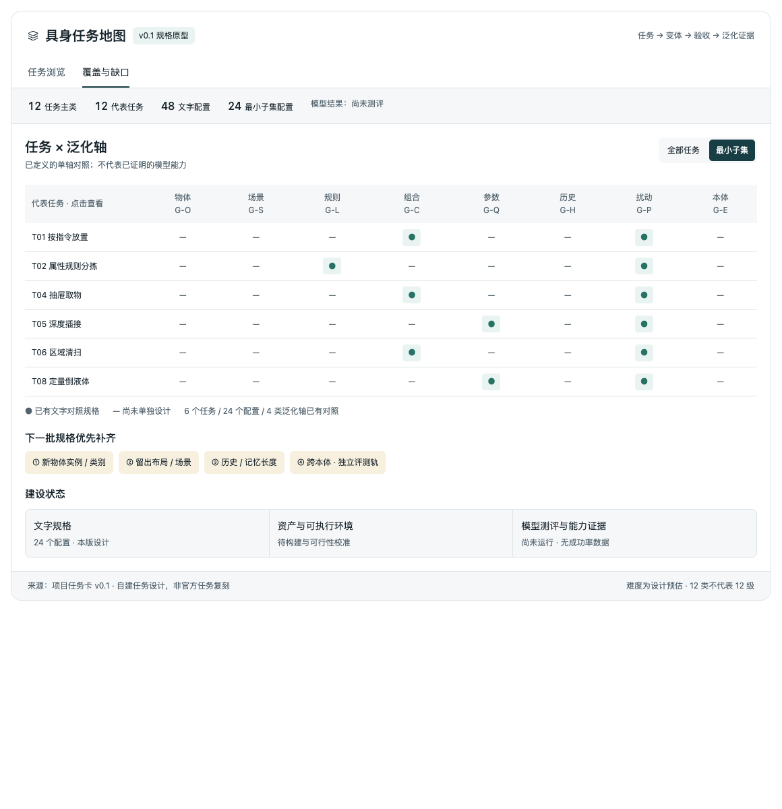

# Embodied Task Atlas · 具身任务地图

面向具身智能的任务分类、泛化变体与测评规格库。

**[在线交互地图](https://pm1255.github.io/embodied-task-atlas/) · [任务数据](data/tasks.json) · [设计说明](specs/task-design-v0.1.zh-CN.md)**



## 当前内容

- 12 个任务主类、12 个代表任务、48 个文字配置。
- 每个任务包括 B（基础）、G（任务变化）、P（扰动）、GP（联合变化）。
- 6 个任务、24 个配置组成最小试测子集。
- 可浏览任务场景、成功条件、难度预估、训练边界与参考来源。
- 覆盖矩阵展示已设计的泛化轴及尚缺少的对照。

这是自建任务规格原型。参考来源不表示已复刻或接入官方 benchmark。资产、可执行环境和模型实验尚未实现；页面中的覆盖标记不是模型成绩。12 类任务不是从易到难的 12 个级别。

## 本地预览

可直接用浏览器打开 `docs/index.html`，无需服务器或 API Key。也可以运行：

```bash
python3 -m http.server 8000 --directory docs
```

然后打开 http://localhost:8000 。

## 更新任务

编辑 `data/tasks.json` 后执行：

```bash
python3 scripts/build.py
```

提交数据与生成的 `docs/` 页面；GitHub Pages 会在推送后重新发布。数据总量会自动更新，预览截图需要在页面发生明显变化后另行更新。

每张卡记录稳定 ID、类别、场景、适配范围、共同成功条件、四组配置、难度与可支持结论、来源和最小子集标记。新卡应明确相对于什么训练/适配范围留出；多个来源描述同一任务时不要重复计算能力种类。

目前采用四组协议；覆盖矩阵将 `axis` 作为任务侧主轴，将 P 组记录为 G-P。跨本体或多轴协议的扩展需要同时修改数据结构与展示，不能只改标签。

## 文件结构

```text
data/tasks.json                # 网页的结构化任务数据源
docs/index.html                # 可直接发布的网页
docs/tasks.json                # 自动生成的公开数据副本
docs/assets/preview.png        # 仓库首页预览
site/index.template.html       # 独立网页模板
site/atlas.fragment.html       # 初始界面源稿（数据占位符）
scripts/build.py               # 校验数据并生成网页
specs/task-design-v0.1.zh-CN.md # 原始文字方案快照
PUBLISH.md                     # GitHub 上传及 Pages 发布步骤
```

日常维护以 `data/tasks.json` 为网页数据源；文字方案是 v0.1 快照，协议变化时应同步更新。界面改动维护 `site/index.template.html`；fragment 保留初始设计来源，不参与日常构建。

## 下一步

1. 收录、去重并映射 benchmark、论文真机任务和企业演示来源。
2. 增补物体、场景、历史记忆与跨本体的独立留出对照。
3. 为任务绑定资产、环境与独立成功判定器。
4. 通过可行性校准后运行成对测评，报告成功率与不确定性。

## 贡献与许可状态

欢迎以 Issue 或 Pull Request 提议任务和补充来源。来源记录应含原链接、任务映射和成功判据；演示成功不能直接记作基准测评结果。

当前是发布准备版本，尚未确定代码与任务规格的许可证；仓库公开不自动等于授予开源使用许可。第三方 benchmark、论文、演示和未来资产各自遵循其原有许可，本仓库当前不分发这些第三方内容。
